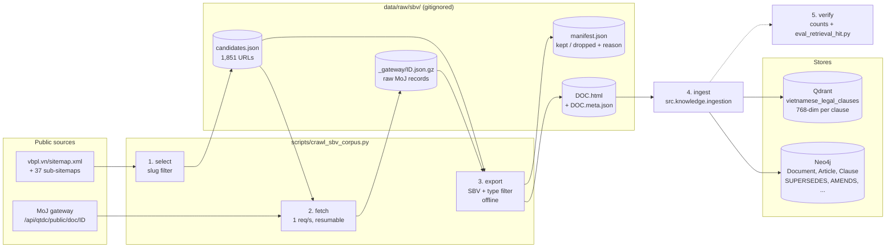
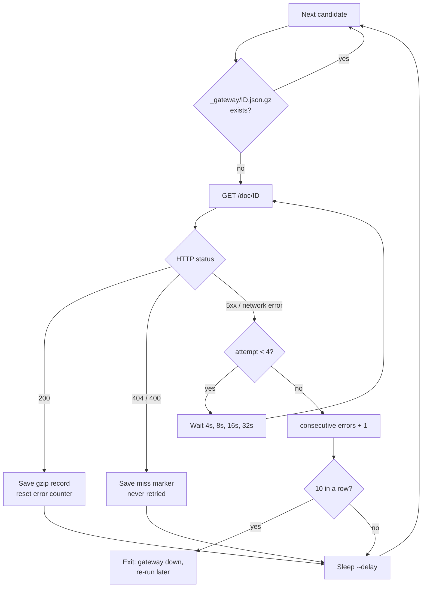
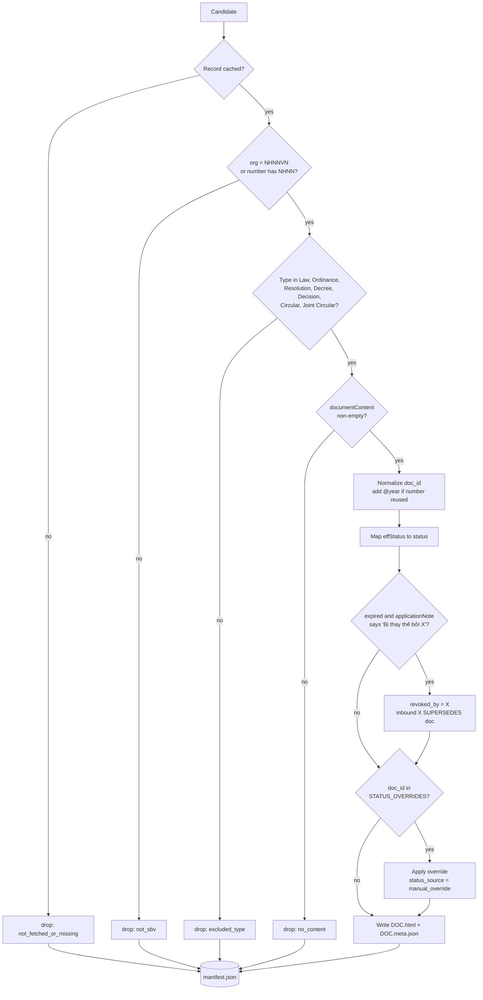
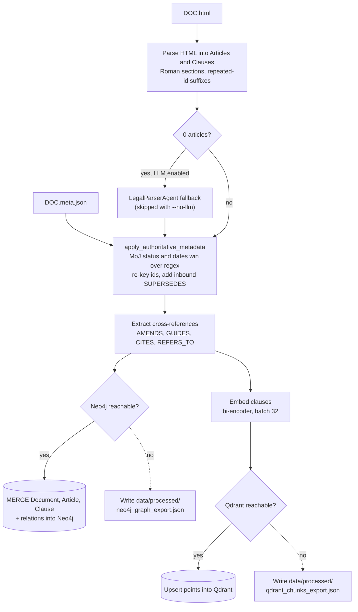

# Runbook: Crawl and Ingest the SBV Corpus

This runbook rebuilds the State Bank of Vietnam (SBV) statutory corpus from vbpl.vn and loads it into Neo4j and Qdrant. The SBV-LawGraph paper (ACIIDS 2026) reports 1,703 SBV documents but does not release them, so we collect them again from the same national database.

| | |
| :--- | :--- |
| **Crawler** | [`scripts/crawl_sbv_corpus.py`](../../scripts/crawl_sbv_corpus.py) |
| **Ingestion** | [`src/knowledge/ingestion.py`](../../src/knowledge/ingestion.py) (`python -m src.knowledge.ingestion`) |
| **Output** | `data/raw/sbv/` (gitignored, about 230 MB), Neo4j graph, Qdrant collection `vietnamese_legal_clauses` |
| **Total time** | About 1h15 on a laptop: fetch about 40 min, ingest about 25 min (CPU embeddings) |
| **Last full run** | 2026-10-27: 1,627 documents kept, all 27 benchmark documents covered |

---

## 1. Pipeline at a Glance



Each stage reads only the previous stage's files, so you can re-run any stage alone. `fetch` is the only stage that downloads documents, and it never downloads a record twice.

---

## 2. Prerequisites

1. **Python environment** with the embeddings extra. Without it, ingestion writes zero vectors and dense retrieval stops working.
   ```bash
   source .venv/bin/activate
   make install-embeddings          # or: pip install -e ".[embeddings]"
   ```
2. **Neo4j and Qdrant running**:
   ```bash
   docker compose up -d neo4j qdrant
   curl -s http://localhost:6333/readyz      # expect "all shards are ready"
   ```
3. **Embedding model cached** (`bkai-foundation-models/vietnamese-bi-encoder`). The first ingest downloads it. After that, set `HF_HUB_OFFLINE=1` to skip hub lookups.
4. **Behind a TLS-inspecting proxy** (for example on the office network), set `LEGALPILOT_USE_SYSTEM_CERTS=1` in `.env`. Otherwise the model download fails with `CERTIFICATE_VERIFY_FAILED`. Do not disable SSL verification instead.
5. **Disk space**: about 250 MB for `data/raw/sbv/` and about 300 MB for the Qdrant collection.

---

## 3. Step by Step

### Step 0: Back up the current stores

Ingestion upserts (`MERGE` in Neo4j, upsert in Qdrant) and never deletes, but a backup makes rollback trivial.

```bash
# Qdrant: server-side snapshot
curl -s -X POST http://localhost:6333/collections/vietnamese_legal_clauses/snapshots

# Copy it out of the container: /qdrant/snapshots is NOT on the storage volume,
# so `docker compose down` deletes it.
mkdir -p data/processed/backup
docker cp legalpilot-qdrant:/qdrant/snapshots/vietnamese_legal_clauses data/processed/backup/qdrant
```

```bash
# Neo4j: dump all nodes and relationships to JSON
python - <<'EOF'
import datetime, json
from pathlib import Path
from src.knowledge.neo4j_client import Neo4jClient
q = Neo4jClient().execute_query
nodes = q("MATCH (n) RETURN elementId(n) AS id, labels(n) AS labels, properties(n) AS props")
rels = q("MATCH (a)-[r]->(b) RETURN elementId(a) AS src, elementId(b) AS dst, "
         "type(r) AS type, properties(r) AS props")
f = Path("data/processed/backup") / f"neo4j_before_sbv_ingest_{datetime.date.today()}.json"
f.parent.mkdir(parents=True, exist_ok=True)
f.write_text(json.dumps({"nodes": nodes, "rels": rels}, ensure_ascii=False, default=str))
print(f, len(nodes), "nodes", len(rels), "rels")
EOF
```

### Step 1: `select` (build the candidate list)

```bash
python scripts/crawl_sbv_corpus.py select
```

- Downloads `https://vbpl.vn/sitemap.xml` and its 37 sub-sitemaps into `data/raw/sbv/_sitemaps/`. They are cached, so delete the folder to pick up newly published documents.
- Keeps URLs whose slug matches one of these groups:

  | Group | Example slug fragment | Kept in last run |
  | :--- | :--- | ---: |
  | `sbv_number` | `-so-40-2024-tt-nhnn` | 1,367 |
  | `sbv_legacy_number` | `-so-22-qd-nh1` | 155 |
  | `banking_keyword` | `luat-...-to-chuc-tin-dung` (Law, Ordinance, Decree, Resolution only) | 98 |
  | `sbv_number_no_year` | `-so-12-tt-nhnn` | 7 |

- Skips consolidated texts (`van-ban-hop-nhat`), directives (`chi-thi`) and `sac-lenh`, which the paper's Table 1 does not count.
- Writes `data/raw/sbv/candidates.json`. Expected size: about 1,850 rows.

### Step 2: `fetch` (download MoJ records)

```bash
python scripts/crawl_sbv_corpus.py fetch                 # all missing records
python scripts/crawl_sbv_corpus.py fetch --limit 5       # quick smoke test
python scripts/crawl_sbv_corpus.py fetch --delay 2.0     # slower, if the server struggles
```

- Calls `https://vbpl-bientap-gateway.moj.gov.vn/api/qtdc/public/doc/{id}` once per candidate. This is the public endpoint the vbpl.vn frontend uses, and it needs no authentication.
- Default throttle: 1 request per second. Expect about 40 minutes for 1,850 records.
- Each response is stored as `data/raw/sbv/_gateway/<id>.json.gz`. **The stage is resumable**: interrupt it with Ctrl+C at any time, and the next run fetches only what is missing.
- Error handling:
  - HTTP 404 or 400 is recorded as a permanent miss and not retried.
  - HTTP 5xx or a network error is retried 4 times with backoff (4s, 8s, 16s, 32s).
  - The run stops after 10 consecutive failures, which usually means the gateway is down. Wait and re-run.
- To force a re-download of one record, delete its `.json.gz` file.



### Step 3: `export` (filter and write ingestion input)

```bash
python scripts/crawl_sbv_corpus.py export
```

This stage works offline. Re-run it whenever you change a filter or an override in the script.

A cached record is kept when all three conditions hold:
1. the drafting organisation is SBV (`organization.code == "NHNNVN"`) or the document number contains `NHNN`;
2. the type is one of Law, Ordinance, Resolution, Decree, Decision, Circular or Joint Circular;
3. the record has non-empty `documentContent`.



For each kept document it writes:
- `<doc>.html`: the official text;
- `<doc>.meta.json`: authoritative metadata. Ingestion trusts this sidecar over regex parsing of the text.

  | Field | Source |
  | :--- | :--- |
  | `doc_id` | `docNum`, normalized (`40/2024/TT-NHNN`). Reused legacy numbers get an `@year` suffix. |
  | `status` | `effStatus.code`: `CHL` and `HHL1P` (partially repealed) become `in_force`, `HHL` becomes `expired`, `CCHL` becomes `not_in_force` |
  | `effective_date`, `expiration_date` | `effFrom`, `effTo` |
  | `inbound_relations`, `revoked_by` | Parsed from `applicationNote` ("Bị thay thế bởi X"), for expired documents only. Becomes `X -[:SUPERSEDES]-> doc`. |
  | `status_source` | `moj_gateway`, or `manual_override` (see below) |

It also writes `manifest.json`, with one row per candidate and the reason it was kept or dropped.

**Manual overrides.** `STATUS_OVERRIDES` in the crawler fixes records where the MoJ data contradicts the instrument itself. Currently:
- `52/2024/ND-CP` is set in force from 2024-07-01 (Art. 37.1);
- `101/2012/ND-CP` is set expired, superseded by 52/2024 (Art. 37.2).

Add an entry there, with the article that justifies it, when you find another contradiction.

**Check the summary.** Last run:
```
export: kept 1627 / 1851 candidates
  reasons: {'sbv_corpus': 1627, 'not_sbv': 222, 'not_fetched_or_missing': 2}
  status:  {'CHL': 545, 'HHL': 866, 'HHL1P': 203, 'CCHL': 13}
  repeal links from applicationNote: 432
```

### Step 4: Ingest into Neo4j and Qdrant

```bash
HF_HUB_OFFLINE=1 python -u -m src.knowledge.ingestion --dir data/raw/sbv --no-llm \
  > data/raw/sbv/ingest.log 2>&1
tail -3 data/raw/sbv/ingest.log      # expect "Ingested 1627/1627 files"
```

- `--no-llm` keeps the run deterministic and free. The regex/HTML parser handles every SBV layout, including pre-2010 Roman-section circulars. Drop the flag only if you want the DeepSeek parser as a fallback for documents the regex cannot split.
- Per document, ingestion runs the flow below.



- **Start Neo4j and Qdrant before ingesting.** If either is unreachable, ingestion does not fail: it writes into the committed offline exports instead (dashed branches above). Those exports back the unit tests, so a run against stopped services changes test fixtures. Check `git status data/processed/` after every run.
- A file that fails is logged and skipped. The run continues, and failures are listed at the end.
- Re-running is safe: IDs are stable, so nodes and points are overwritten, not duplicated.
- If the log shows `Embedding failed for <doc>, using zero vectors`, stop the run. The embeddings extra is missing or the model cannot be loaded (see Prerequisites).

### Step 5: Verify

```bash
python - <<'EOF'
from src.knowledge.neo4j_client import Neo4jClient
q = Neo4jClient().execute_query
print(q("MATCH (n) RETURN labels(n)[0] AS label, count(*) AS c ORDER BY c DESC"))
print(q("MATCH ()-[r]->() RETURN type(r) AS t, count(*) AS c ORDER BY c DESC"))
EOF
curl -s http://localhost:6333/collections/vietnamese_legal_clauses | python -c \
  "import json,sys; print('qdrant points:', json.load(sys.stdin)['result']['points_count'])"
```

Reference values from the 2026-10-27 run (graph on top of the earlier demo data):

| Check | Expected |
| :--- | ---: |
| Document nodes | about 2,525 (about 890 are stubs: referenced instruments outside the corpus) |
| Article / Clause nodes | about 21,200 / 67,000 |
| `SUPERSEDES` edges | about 500 |
| Qdrant points | about 67,000 |

For a deeper, read-only inspection use [`scripts/inspect_ingested_data.py`](../../scripts/inspect_ingested_data.py). Cypher queries for Neo4j Browser and Qdrant REST calls are in [inspect-ingested-data.md](inspect-ingested-data.md).

```bash
python scripts/inspect_ingested_data.py summary                       # counts, status mix, vector config
python scripts/inspect_ingested_data.py doc 40/2024/TT-NHNN --article 18
HF_HUB_OFFLINE=1 python scripts/inspect_ingested_data.py search "điều kiện mở ví điện tử"
python scripts/inspect_ingested_data.py check                         # exit 1 if any FAIL
```

`check` compares the stores against `manifest.json`: every corpus document present with metadata, every clause with a vector (matched by `uuid5(clause_id)`), no zero vectors, no chunks built from benchmark answers, and status contradictions.

Then run the retrieval-only check (no LLM, under a minute):

```bash
HF_HUB_OFFLINE=1 python scripts/eval_retrieval_hit.py
```

Expect doc Hit@10 of about 93%, article Hit@10 of about 91%, and an in-force share above 90%. A sharp drop usually means zero vectors or a stale Qdrant collection. A score well above that usually means leaked benchmark chunks are still in Qdrant: run `inspect_ingested_data.py check`, which fails in that case. As of 2026-10-28 the live store still holds 90 of them, which lift the score to 98% / 96%.

---

## 4. Common Re-runs

| Situation | Run |
| :--- | :--- |
| Changed a filter, override or repeal-note regex in the crawler | `export`, then ingest |
| Changed the parser in `ingestion.py` | ingest only |
| Want newly published documents | delete `data/raw/sbv/_sitemaps/`, then `all`, then ingest |
| One record looks wrong or truncated | delete `_gateway/<id>.json.gz`, then `fetch`, `export`, ingest |
| Full rebuild from scratch | `python scripts/crawl_sbv_corpus.py all`, then ingest |

To re-ingest a handful of files instead of the whole folder:
```bash
python -m src.knowledge.ingestion --file data/raw/sbv/40_2024_TT-NHNN.html --no-llm
```

---

## 5. Known Issues

- **Two records always return HTTP 500** (`23030`, `23442`). The fault is on the server side. They show up as `not_fetched_or_missing` in the manifest. Do not keep retrying them.
- **About 435 expired documents have no replacement link.** MoJ did not record "Bị thay thế bởi" for them. They are still pruned at generation time because their status is `expired`, but selective traversal cannot reach their successor.
- **Corpus size is 1,627, not 1,703.** The paper's exact selection rule is unpublished. Our type and status mix is close to its Table 1 (748 in-force documents with 9,725 articles, against the paper's 840 and 9,661).
- **Offline JSON exports are not updated.** `data/processed/neo4j_graph_export.json` and `qdrant_chunks_export.json` still hold the small demo set that the unit tests use. A full vector export would be over 500 MB, so it must not be committed.
- **Stale nodes after an ID change.** Ingestion never deletes. If a document's `doc_id` changes (for example a new `@year` suffix), the old node stays. Remove it by hand, or restore from backup and re-ingest.

---

## 6. Rollback

```bash
# Qdrant: upload the snapshot saved in Step 0
curl -X POST "http://localhost:6333/collections/vietnamese_legal_clauses/snapshots/upload?priority=snapshot" \
  -F "snapshot=@data/processed/backup/qdrant/<snapshot-file>.snapshot"
```

For Neo4j, the JSON dump from Step 0 is a raw record of the graph, not a loader input. The quickest way back to the demo graph is `python scripts/load_neo4j_from_export.py`, which **wipes the database** and reloads `data/processed/neo4j_graph_export.json`.

---

## 7. Crawling Etiquette

- Use only the sitemaps (allowed by `vbpl.vn/robots.txt`) and the per-document gateway endpoint. `robots.txt` disallows `/api/` on vbpl.vn, and the gateway's search endpoint requires authentication. Do not probe other gateway endpoints.
- Keep `--delay` at 1 second or more. The crawler identifies itself with `User-Agent: LegalPilot-VN/1.0 (Educational Academic Agentic RAG; HCMUT)`.
- Never commit `data/raw/sbv/`. It is covered by the `data/raw/*` rule in `.gitignore`.
